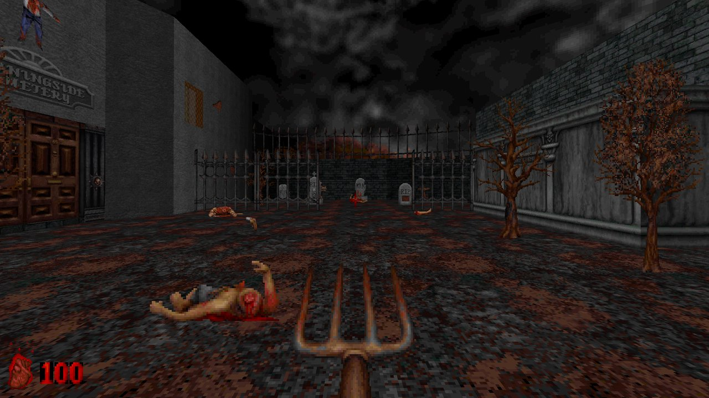
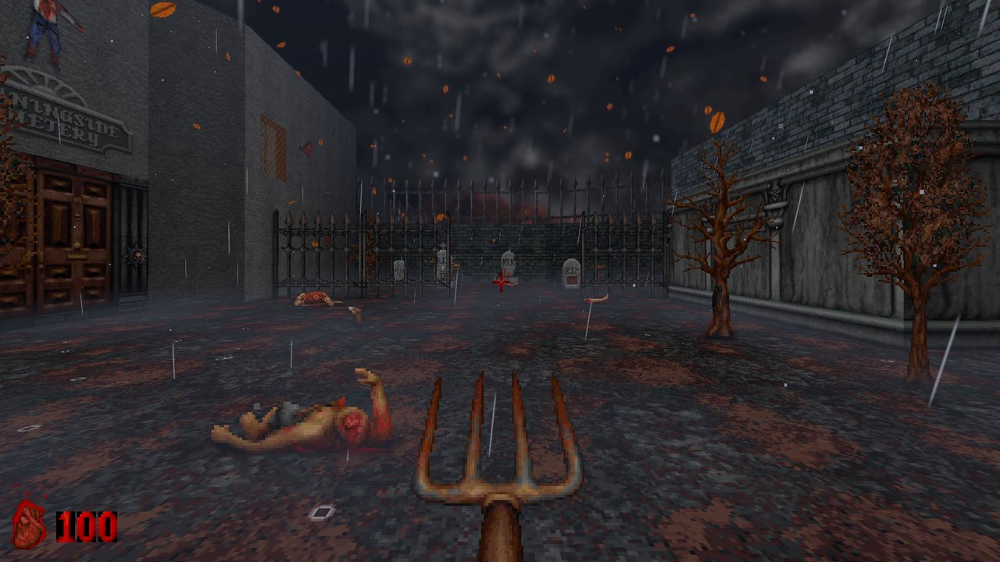
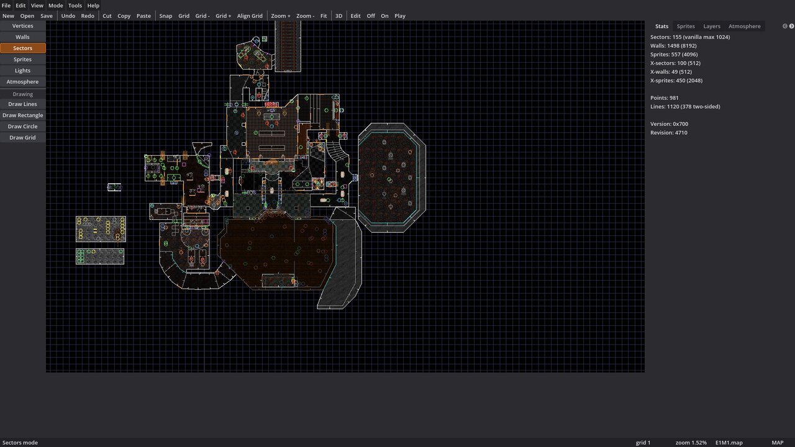
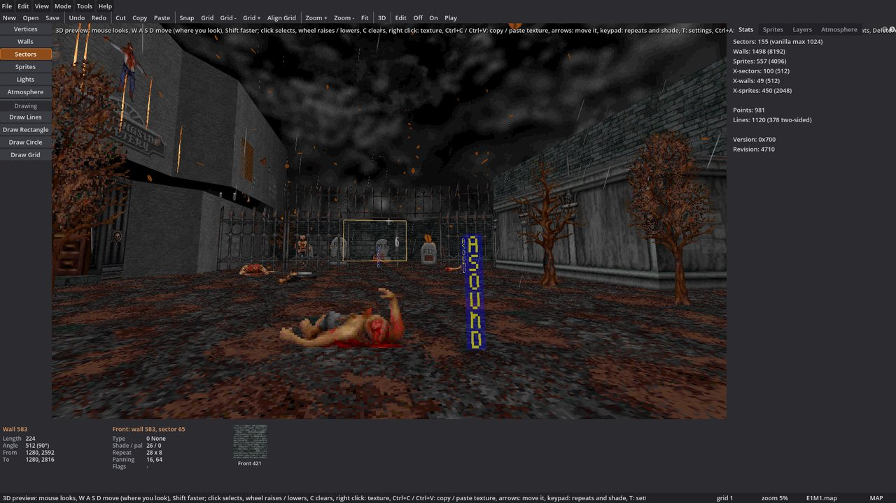

# Chosen

Blood (Monolith, 1997) rebuilt in Godot 4.7 and C#, with a modern map editor beside it. Chosen plays Blood's own
levels straight from their .MAP files, as Blood plays them ([NBlood](https://github.com/nukeykt/NBlood) is the
reference), and draws them either as Blood did or with a new look: fog, rain and dynamic light.

Chosen is an unofficial fan project. **It needs your own copy of Blood** (Blood: Refreshed Supply on Steam or GOG): it
reads Blood's art, sounds, music and levels from your install, and this repository holds none of them.

| Classic | Enhanced |
|---|---|
|  |  |

*E1M1's cemetery yard. F10 in the game switches between the two.*

## The game

- **Blood as it plays:** the levels, monsters, weapons, sector effects and triggers from Blood's own data, checked
  against NBlood view by view. Voxel models for the items and props that have them.
- **Classic or enhanced, each effect your choice** (Options > Enhanced): distance fog and mist on the ground, rain,
  snow and falling leaves blown by the wind, lightning, dynamic lights with shadows from flames, lamps and gunfire,
  water you can see into with reflections, caustics and ripples, moonlight, embers, smoke and dust, ambient
  occlusion. The classic palette look is an option too.
- **HDR output** on HDR screens (Windows, Direct3D 12): bright lights, flames and fog glow go past ordinary white up to
  your screen's peak, with the white level, peak and the UI's brightness set in Options > Video > HDR.
- **Add-ons:** Refreshed Supply's Death Wish, Cryptic Passage and MARROW, and mods made for NBlood, such as
  Eviction, with NoOne's modern map features (custom enemies, patrols,
  conditions and the rest) that such mods use.

## Chosen Forge, the map editor

| 2D | 3D preview |
|---|---|
|  |  |

A map editor for Blood levels in the manner of UltimateDoomBuilder:

- **Classic maps:** opens and saves Blood's .MAP files (a map opened and saved unchanged comes back byte for byte),
  with Blood's limits, types and triggers known: x-object fields named, links between rooms, doors and lifts made for
  you, Map Analysis of what a map's events and keys need.
- **.MAPX, Chosen's own format:** everything a .MAP holds, and what it can't: layers, names, the map's own dynamic
  lights, atmospheres (fog, ground mist, rain, snow and wind per area), its own art. The format is versioned, so maps
  made now keep opening as it grows. A .MAPX converts back to a .MAP, saying what Blood can't keep.
- **A 3D preview** that looks like the game, weather and all, where walls, floors and sprites are picked and edited,
  and **Test Map** (F9), which plays the map in Chosen.
- Maps of a mod's folder are opened with that mod's art and data.

## Playing

Download the latest release from the [Releases](../../releases) page (Windows, 64-bit): `Chosen-<version>-windows-x64.zip`
for the game, `ChosenForge-<version>-windows-x64.zip` for the map editor (unpack the two side by side: Forge's Test Map finds the game). Unpack the game and run ChosenLoader.exe
once: it finds your Blood install, lets you pick the add-ons (Death Wish, Cryptic Passage, MARROW, mods made for
NBlood) and extracts what the game needs into `data\` beside Chosen.exe. Then run Chosen.exe. After an update, run
ChosenLoader again when the title screen asks for it.

The programs aren't signed, so Windows may warn the first time you start one (More info > Run anyway).

## Building from source (Windows)

1. **Godot 4.7.2 .NET** (`Godot_v4.7.2-stable_mono_win64.zip` from godotengine.org), unpacked into
   `tools/godot-4.7-mono/` so that `tools/godot-4.7-mono/Godot_v4.7.2-stable_mono_win64/` holds its exe files, and
   the **.NET 8 SDK**.
2. **The data folder**, extracted from your Blood install:
   `dotnet run --project shared/Chosen.MapTool -- extract "<Blood folder>" game/blood3d --addons all`.
3. `godot\play.bat` builds the game and starts it (`godot\play.bat e1m1` goes straight into a level);
   `forge\run.bat` starts Chosen Forge. `build_dist.bat` makes the release folders, `build_release.bat` the release
   zips (`CONTRIBUTING.md` "Versions").

The development tools (the bug tracker, the regression tests, the comparisons with NBlood) also need **Python 3** with
Pillow (`pip install pillow`). The scripts find your Blood install as ChosenLoader does (Steam's and GOG's folders), or take the `BLOOD`
environment variable. The
references go in `third_party/` (git-ignored), each from its own repository:

| Folder | From | For |
|---|---|---|
| `third_party/nblood` | https://github.com/nukeykt/NBlood (`build_nblood.bat` applies `pipeline/nblood_b3dview.patch` and builds it; Visual Studio 2022) | the reference; `pipeline/bugs.py nblood`, `pipeline/compare.py`, `godot\playat.bat nblood` |
| `third_party/xmapedit` | https://github.com/NoOneBlood/xmapedit (`build_xmapedit.bat`) | Blood's editing rules, for Forge |
| `third_party/udb` | https://github.com/UltimateDoomBuilder/UltimateDoomBuilder | how Forge's editing works |

## In this repository

| Folder | What |
|---|---|
| `godot/` | The game (Godot C# project, `Chosen.csproj`); how it works: **[godot/README.md](godot/README.md)** |
| `forge/` | Chosen Forge, the map editor: **[forge/README.md](forge/README.md)**; its plan is `PLAN.md` |
| `loader/` | ChosenLoader, which sets up a player's data folder from their Blood install |
| `shared/` | The libraries the game, Forge and the loader share: `Chosen.Engine` (the clean core), `Chosen.Blood` (Blood's files and map format), `Chosen.MapTool` (their command line) |
| `pipeline/` | Python tools: the bug tracker and regression tests (`bugs.py`), map comparison with NBlood (`compare.py`), walk tests, the older Python extraction |
| `bugs/` | Bug reports (their text, setup and input recordings: the pictures stay with whoever made them) and the regression sets, `bugs/regression/` |
| `dist/` | The release folders' README files |

`CLAUDE.md` holds the working rules for Claude Code sessions on this repository (the testing rules hold for anyone).

## Licence

Chosen is GPL v2, like NBlood; the game's ports of Build's engine code are also under Ken Silverman's Build licence.
See [LICENSE.md](LICENSE.md), and [CONTRIBUTING.md](CONTRIBUTING.md) before sending changes.

## History

Chosen was called Blood3D. It began as a DarkPlaces (Quake engine) game with Blood's levels converted to brush maps,
then moved to Godot, at first on those brush maps and then on Blood's own .MAP files.
